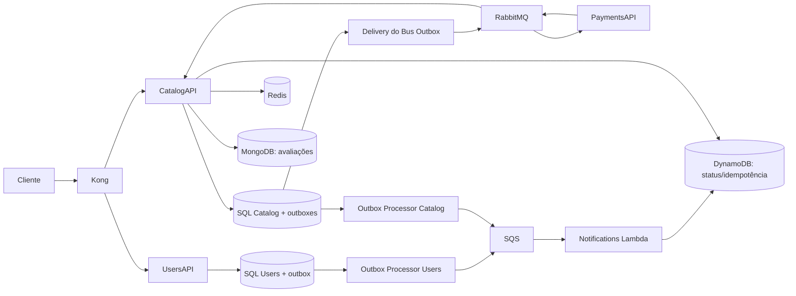

# Arquitetura do FCG para a Fase 4

Situação documentada em 10/11/2026, conforme a `master` disponível. A arquitetura mantém os fluxos de pagamento da Fase 2 e a evolução de notificações da Fase 3, acrescentando a preparação dos requisitos da Fase 4.

## Componentes e responsabilidades

| Componente | Responsabilidade | Persistência / comunicação |
|---|---|---|
| Kong | Entrada HTTP e validação JWT nas rotas protegidas | Encaminha para UsersAPI e CatalogAPI |
| UsersAPI | Cadastro, login, JWT e seed de administrador | SQL Server `FCGUsersDb`; usuário e outbox na mesma transação |
| CatalogAPI | Jogos, pedidos, biblioteca, avaliações e consulta administrativa de notificações | SQL Server `FCGCatalogDb`, MongoDB, Redis, RabbitMQ e leitura do DynamoDB |
| PaymentsAPI | Simular aprovação/rejeição de pagamento | RabbitMQ/MassTransit; sem banco próprio |
| Outbox Processor | Publicar eventos de notificação persistidos em SQL | Dois processos, um por banco, publicando na SQS |
| Notifications Lambda | Processar notificações e registrar status/idempotência | SQS e DynamoDB, conforme integração descrita no Orchestration |
| Prometheus / Grafana | Coletar e visualizar métricas | `/metrics` das APIs e dashboards versionados |
| NotificationsAPI | Implementação histórica de notificações da Fase 2 | Não participa do Compose atual |

Os fontes do worker e da Lambda não estavam clonados nesta pasta na revisão. As responsabilidades desses dois componentes são descritas pelos pontos de integração e scripts do Orchestration; precisam ser verificadas nos respectivos repositórios.

## Cadastro e autenticação

1. `POST /api/auth/register` valida o cadastro e persiste usuário com role `User` e notificação `UserCreated` na mesma transação SQL.
2. O worker de Users publica a notificação na SQS. O processo HTTP não publica diretamente.
3. A Lambda consome a notificação; o processamento pode ocorrer depois da resposta HTTP.
4. `POST /api/auth/login` retorna JWT com identificação e role. Existe seed de administrador configurável por `Admin__Email` e `Admin__Password`.

Não existe endpoint de promoção de role na UsersAPI atual. O CatalogAPI exige `Admin` para escrita de jogos e consulta administrativa de status. Compra e biblioteca verificam o dono pelo `user_id` do token. O gateway não substitui essas verificações.

## Compra e pagamento

1. CatalogAPI recebe `POST /api/library/purchase`, valida JWT, dono e jogo ativo.
2. Na mesma transação, grava pedido `Pending`, notificação `OrderPlaced` em `dbo.OutboxMessages` e o evento de pagamento no Bus Outbox do MassTransit.
3. O delivery do MassTransit publica `OrderPlacedEvent` no RabbitMQ; PaymentsAPI consome na fila `payments-order-placed`.
4. PaymentsAPI publica `PaymentProcessedEvent`. Por padrão aprova; `Payments__ForceRejected=true` força rejeição.
5. CatalogAPI consome na fila `catalog-payment-processed`, valida os dados do pedido e atualiza seu estado. Se aprovado, inclui o jogo na biblioteca.
6. Na transação de atualização, grava também a notificação `PaymentProcessed` na outbox SQL, que segue por worker/SQS/Lambda.

As tabelas `messaging.InboxState`, `messaging.OutboxMessage` e `messaging.OutboxState` atendem ao MassTransit. `dbo.OutboxMessages` atende ao fluxo de notificações. São mecanismos separados.

## Persistência poliglota

- **SQL Server:** usuários, jogos, pedidos, biblioteca e outboxes. Scripts idempotentes em `k8s/database/scripts`; `database-init` no Compose e init containers nas APIs no Kubernetes. Não depende de `EnsureCreated` para preparar esses schemas.
- **MongoDB:** collection `reviews`, com autor, jogo, nota de 1 a 5, comentário e data. O serviço verifica a existência do jogo ativo no SQL e usa `MongoDB.Driver` para inserir/listar avaliações, ordenadas da mais recente para a mais antiga. Há índice por `gameId`.
- **Redis:** cache da listagem de jogos por página/tamanho. O prefixo da instância é `fcg:`; as chaves incluem a versão da listagem e têm TTL de 5 minutos. Criar, editar ou desativar jogo muda a versão do cache. Falhas de cache são logadas e a consulta pode voltar ao SQL. Sem configuração Redis, o código usa cache distribuído em memória do processo, que não atende ao requisito de distribuição entre réplicas.
- **DynamoDB:** consulta do status de notificações, cruzando IDs da outbox com registros da tabela de idempotência. Não é a origem dos jogos nem das avaliações.

## Busca planejada para integração

A `master` ainda não possui `/search`. A branch `feature/elasticsearch` contém um índice separado do SQL, busca fuzzy, relevância e sincronização ao alterar jogos. O desenho final deve usar Elasticsearch/OpenSearch gerenciado. Após integração, validar recuperação de falhas de indexação e reindexação antes de declarar consistência do índice.

## Infraestrutura disponível e limites

O Compose local usa LocalStack para SQS/Lambda/DynamoDB. O overlay `docker-compose.production.yml` usa imagens GHCR e AWS real para notificações, mas mantém APIs, bancos, cache e gateway locais: é um modo híbrido, não prova de execução em Kubernetes gerenciado.

`kubectl apply -k k8s` aplica somente os recursos listados no `k8s/kustomization.yaml`: SQL Server, Secrets associados, RabbitMQ, Redis, MongoDB e inicialização do banco. Gateway, monitoramento, APIs, workers e Lambda exigem preparação separada. Os manifests atuais não equivalem a um provisionamento de EKS/AKS/GKE/OKE.

As probes `/health` das APIs respondem com o estado HTTP do processo; não realizam uma verificação completa das dependências. MongoDB/Redis nos manifests atuais não têm PVC. Persistência, recuperação e comportamento no rollout devem ser validados no ambiente final.

As pipelines atuais testam e publicam imagens `latest` no GHCR. Não atualizam o cluster automaticamente. Injeção via `secretKeyRef` existe, mas ainda há valores fixos versionados, inclusive configuração JWT do Kong. Essas pendências estão na [matriz da Fase 4](FASE4.md).
