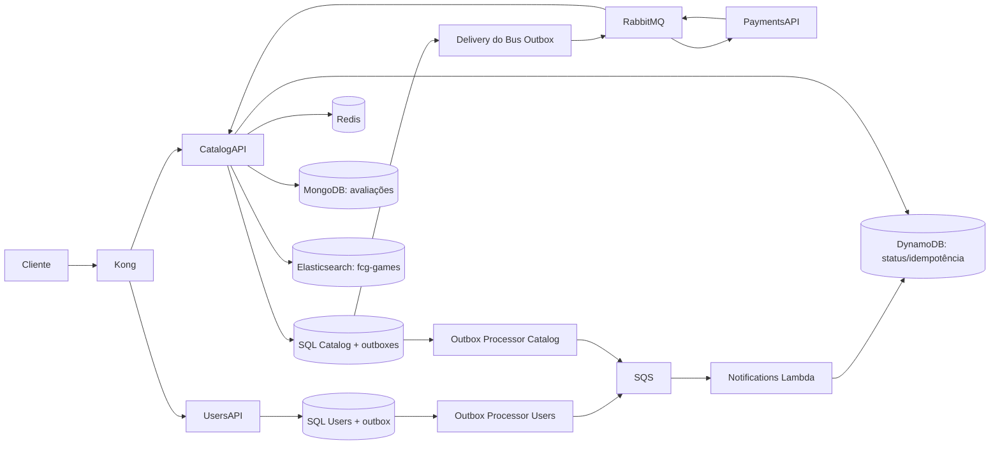

# Arquitetura do FCG para a Fase 4

Revisão documental em 16/11/2026 conforme a `master`, preservando o registro de execução de
11/11/2026 no Amazon EKS `fcg-eks` (`us-east-1`). Esta revisão não consultou o ambiente ao vivo.
A arquitetura mantém os fluxos de pagamento da Fase 2 e as notificações da Fase 3; a matriz
separa implementação, registros históricos e requisitos ainda pendentes.

## Componentes e responsabilidades

| Componente | Responsabilidade | Persistência / comunicação |
|---|---|---|
| Kong | Entrada HTTP e validação JWT nas rotas protegidas | Encaminha para UsersAPI e CatalogAPI |
| UsersAPI | Cadastro, login, JWT e seed de administrador | SQL Server `FCGUsersDb`; usuário e outbox na mesma transação |
| CatalogAPI | Jogos, pedidos, biblioteca, avaliações, busca `/search` e consulta administrativa de notificações | SQL Server `FCGCatalogDb`, MongoDB, Redis, Elasticsearch, RabbitMQ e leitura do DynamoDB |
| Elasticsearch | Índice de jogos para fuzzy search e relevância (`fcg-games`) | Serviço no cluster EKS (`elasticsearch:9200`); não é Amazon OpenSearch Service |
| PaymentsAPI | Simular aprovação/rejeição de pagamento | RabbitMQ/MassTransit; sem banco próprio |
| Outbox Processor | Publicar eventos de notificação persistidos em SQL | Dois processos, um por banco, publicando na SQS |
| Notifications Lambda | Processar notificações e registrar status/idempotência | SQS e DynamoDB, conforme integração descrita no Orchestration |
| Prometheus / Grafana | Coletar e visualizar métricas | `/metrics` das APIs e dashboards versionados |
| NotificationsAPI | Implementação histórica de notificações da Fase 2 | Não participa do Compose atual |

Os fontes do worker e da Lambda não estavam clonados nesta pasta na revisão. As responsabilidades desses dois componentes são descritas pelos pontos de integração e scripts do Orchestration; precisam ser verificadas nos respectivos repositórios.

## Cadastro e autenticação

1. `POST /api/auth/register` valida o cadastro e persiste usuário com role `User` e notificação `UserCreated` na mesma transação SQL.
2. O worker de Users publica a notificação na SQS. O processo HTTP não publica diretamente.
3. A Lambda consome a notificação; o processamento pode ocorrer depois da resposta HTTP.
4. `POST /api/auth/login` retorna JWT com identificação e role. Existe seed de administrador configurável por `Admin__Email` e `Admin__Password`.

Não existe endpoint de promoção de role na UsersAPI atual. O CatalogAPI exige `Admin` para escrita de jogos e consulta administrativa de status. Compra e biblioteca verificam o dono pelo `user_id` do token. O gateway não substitui essas verificações.

## Compra e pagamento

1. CatalogAPI recebe `POST /api/library/purchase`, valida JWT, dono e jogo ativo.
2. Na mesma transação, grava pedido `Pending`, notificação `OrderPlaced` em `dbo.OutboxMessages` e o evento de pagamento no Bus Outbox do MassTransit.
3. O delivery do MassTransit publica `OrderPlacedEvent` no RabbitMQ; PaymentsAPI consome na fila `payments-order-placed`.
4. PaymentsAPI publica `PaymentProcessedEvent`. Por padrão aprova; `Payments__ForceRejected=true` força rejeição.
5. CatalogAPI consome na fila `catalog-payment-processed`, valida os dados do pedido e atualiza seu estado. Se aprovado, inclui o jogo na biblioteca.
6. Na transação de atualização, grava também a notificação `PaymentProcessed` na outbox SQL, que segue por worker/SQS/Lambda.

As tabelas `messaging.InboxState`, `messaging.OutboxMessage` e `messaging.OutboxState` atendem ao MassTransit. `dbo.OutboxMessages` atende ao fluxo de notificações. São mecanismos separados.

## Persistência poliglota

- **SQL Server:** usuários, jogos, pedidos, biblioteca e outboxes. Scripts idempotentes em `k8s/database/scripts`; `database-init` no Compose e init containers nas APIs no Kubernetes. Não depende de `EnsureCreated` para preparar esses schemas.
- **MongoDB:** collection `reviews`, com autor, jogo, nota de 1 a 5, comentário e data. O serviço verifica a existência do jogo ativo no SQL e usa `MongoDB.Driver` para inserir/listar avaliações, ordenadas da mais recente para a mais antiga. Há índice por `gameId`.
- **Redis:** cache da listagem de jogos por página/tamanho. O prefixo da instância é `fcg:`; as chaves incluem a versão da listagem e têm TTL de 5 minutos. Criar, editar ou desativar jogo muda a versão do cache. Falhas de cache são logadas e a consulta pode voltar ao SQL. Sem configuração Redis, o código usa cache distribuído em memória do processo, que não atende ao requisito de distribuição entre réplicas.
- **DynamoDB:** consulta do status de notificações, cruzando IDs da outbox com registros da tabela de idempotência. Não é a origem dos jogos nem das avaliações.

## Busca (Elasticsearch)

A CatalogAPI na `master` expõe `/search` e `/api/games/search` (também via Kong) com fuzzy search,
score e sincronização/reindexação de jogos. O índice `fcg-games` fica no Elasticsearch do EKS
(`ConnectionStrings__Elasticsearch=http://elasticsearch:9200`). O motor é operado pelo grupo em
Deployment; Kubernetes gerenciado não o transforma em Elasticsearch gerenciado. A exigência de
serviço de busca gerenciado do enunciado permanece pendente de adequação ou confirmação docente.
Falhas de sincronização são logadas sem desfazer a alteração SQL; reindexação é necessária para
recuperar divergências. `POST /api/games/reindex` exige Admin.

## Infraestrutura disponível e limites

O Compose local usa LocalStack para SQS/Lambda/DynamoDB. O overlay `docker-compose.production.yml` continua sendo modo híbrido local+AWS de notificações.

Em nuvem, o cluster **Amazon EKS** `fcg-eks` hospeda Kong (LoadBalancer), APIs, SQL Server, Redis, MongoDB, RabbitMQ e Elasticsearch. Provisionamento e operação estão em [CICD.md](CICD.md) e nos scripts `scripts/provision-*.sh` / `apply-*.sh`.

As probes `/health` refletem o processo HTTP. MongoDB/Redis/Elasticsearch nos manifests atuais
não definem PVC; a recriação do Pod pode perder dados. Isso é uma limitação de persistência e
recuperação, não uma garantia de adequação da entrega. A demonstração de continuidade de tráfego
durante rollout também precisa de evidência além das probes e `maxUnavailable: 0`.

As pipelines publicam imagens versionadas por SHA no **Amazon ECR** e fazem rolling update no EKS via OIDC. Detalhes e matriz de requisitos: [FASE4.md](FASE4.md).
